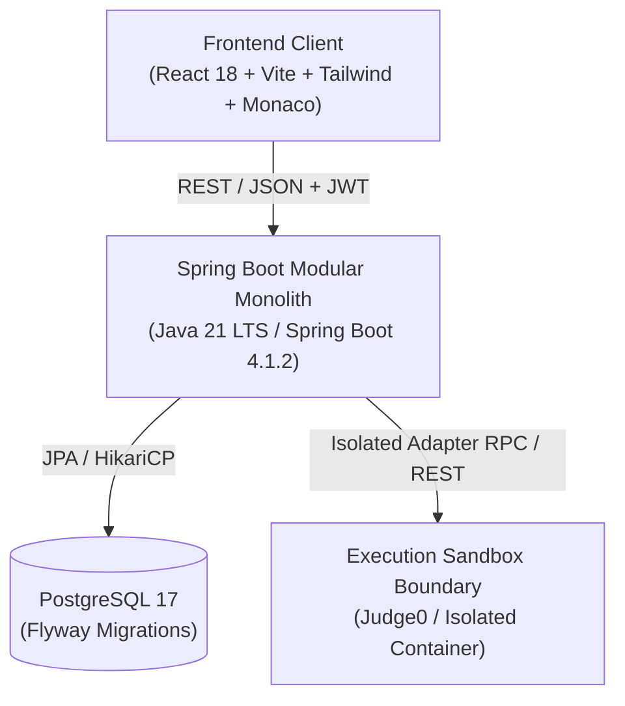
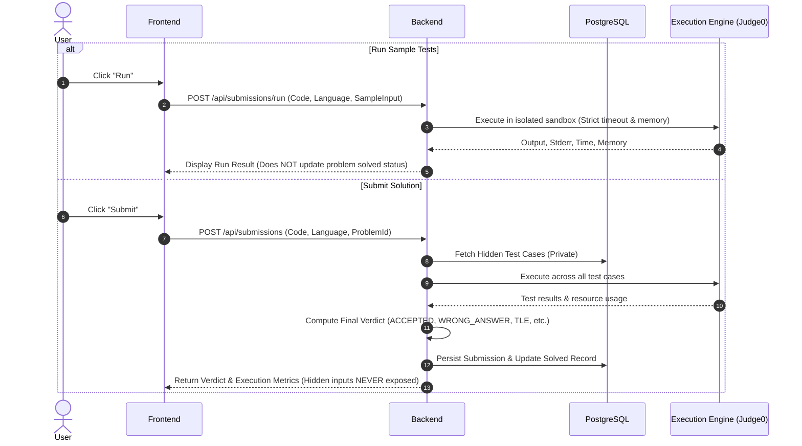

# CodeArena — System Architecture Specification

## 1. Architectural Philosophy

CodeArena is architected as a clean **Modular Monolith** designed for high cohesion, strict domain separation, and long-term extensibility. It balances operational simplicity in Phase 1 with strict architectural boundaries so future engineering assessment tracks (APIs, Projects, AI/ML, SQL, Quizzes) can be integrated without rewriting the platform core.



---

## 2. Frontend Architecture

The frontend is built using **React 18**, **TypeScript**, **Vite**, and **Tailwind CSS**.

### Key Layers:
- **Pages (`src/pages/`)**: Route-level components handling lifecycle, routing parameters, and view assembly (`ProblemsPage`, `ProblemDetailPage`, `SubmissionsPage`, `DashboardPage`).
- **Components (`src/components/`)**:
  - Reusable layout primitives (`Header`, `Footer`, `Sidebar`).
  - Specialized widgets (`StatusCard`, `ProblemCard`, `VerdictBadge`).
  - Code Workspace (`MonacoCodeEditor`, `ConsoleOutputPanel`, `TestCaseTabs`).
- **API Clients (`src/api/`)**: Centralized HTTP client layer with automatic JWT token attachment, centralized error formatting, and request cancellation.
- **Context & State Management (`src/context/`)**: Lightweight state boundaries (`AuthContext`, `ThemeContext`) paired with TanStack Query for server state caching and optimistic UI updates.
- **Type Definitions (`src/types/`)**: Single source of truth for domain data contracts matching backend DTO schemas.

---

## 3. Backend Modular Monolith Architecture

The backend is built using **Java 21 LTS** and **Spring Boot 4.1.2** (Spring Framework 7), following domain-driven package organization:

```
com.codearena
├── common/        # Global exception handling, standard ApiResponse<T>, pagination, base config
├── auth/          # Spring Security, JWT token provider/filter, login/register controllers
├── user/          # User domain, roles (USER, ADMIN), profile management, repository
├── problem/       # Problem, topic, test case entities, search filters, pagination DTOs
├── admin/         # Admin endpoints for authoring, editing, and publishing problems
├── submission/    # Submission orchestrator, Run vs Submit lifecycle, verdict engine
├── execution/     # Sandboxed code execution adapter boundary (Judge0 contract)
├── dashboard/     # User analytics, streaks, difficulty counts, topic progress
└── draft/         # Code draft persistence per user, problem, and language
```

### Architectural Rules:
1. **Controllers are Thin**: Controllers perform request routing, validation, and return standard `ApiResponse<T>`. All domain rules live in `@Service` classes.
2. **DTO Boundaries**: JPA entities are never returned directly over the wire. Separate request DTOs (`*Request`) and response DTOs (`*Response`) isolate the database schema from API contracts.
3. **Fail-Fast Validation**: Jakarta Bean Validation (`@Valid`, `@NotBlank`, etc.) validates incoming payloads before entering domain logic.
4. **Centralized Exceptions**: `@RestControllerAdvice` converts domain and validation errors into consistent RFC-compliant JSON responses.

---

## 4. Database Schema & Migration Strategy

CodeArena uses **PostgreSQL** managed strictly via **Flyway** migrations in `src/main/resources/db/migration/`.

### Migration Policy:
- Schema changes are append-only.
- In Milestone 1, foundational tables (`users` with role constraints and indexing) are initialized in `V1__initial_foundation_schema.sql`.
- Future milestone tables (`problems`, `topics`, `test_cases`, `submissions`, `drafts`) will be added incrementally via versioned migrations (`V2`, `V3`, etc.).
- Never commit hardcoded production credentials. Configuration uses Spring property placeholders (`${SPRING_DATASOURCE_URL}`, etc.).

---

## 5. Submission Lifecycle & Execution Boundary

One of CodeArena's core architectural tenets is the **absolute isolation of untrusted user code execution**.

### Execution Boundary Contract:
The interface `com.codearena.execution.contract.CodeExecutionService` abstracts the execution provider:
```java
public interface CodeExecutionService {
    ExecutionResponse execute(ExecutionRequest request);
    boolean isAvailable();
}
```

### Run vs. Submit Workflow Separation:


---

## 6. Security Considerations & Authentication Architecture

1. **JWT Stateless Authentication**:
   - Built on Spring Security's OAuth2 Resource Server and Nimbus JOSE JWT.
   - Access tokens signed using HMAC-SHA256 (`HS256`) with a 256-bit cryptographically secure secret (`JWT_SECRET`).
   - Claims include subject (`sub`), user ID (`userId`), email (`email`), role (`role`), issue timestamp (`iat`), and expiration timestamp (`exp`).
   - Stateless session management (`SessionCreationPolicy.STATELESS`); no HTTP session state retained on the server.
   - Spring Security configured with custom JSON `AuthenticationEntryPoint` (401) and `AccessDeniedHandler` (403) to ensure clean RFC-compliant API error formats.

2. **Password Security**:
   - Passwords hashed using `BCryptPasswordEncoder` with strength factor 12.
   - Passwords are never stored in plain text and are never returned in DTO responses (`@JsonIgnore` and selective response DTOs).
   - Enforces password complexity (minimum 8 characters, uppercase, lowercase, number, special character).

3. **Role-Based Access Control (RBAC)**:
   - Built-in roles: `ROLE_USER`, `ROLE_ADMIN`.
   - Method security enabled via `@EnableMethodSecurity`.
   - Privilege escalation prevention: user profile endpoints (`PUT /api/users/me`) only permit editing `username` and `displayName`; roles cannot be modified by users.
   - Self-registration strictly defaults to `ROLE_USER`.

4. **Sandboxed Code Execution**:
   - Untrusted code is never compiled or executed inside the backend host process.
   - Dedicated containers run with unprivileged user permissions, dropped Linux capabilities, disabled network access (`--net=none`), CPU quotas, and strict memory limits.

5. **Hidden Test Confidentiality**:
   - Hidden test case inputs and expected outputs are never returned to client endpoints under any circumstance.
   - Clients only receive aggregate verdicts, test case counts (e.g., "Passed 15/15"), and sample test feedback.

6. **Credential & Secret Protection**:
   - Secrets and connection strings are injected via environment variables.
   - Password hashing uses BCrypt with adaptive work factors.
